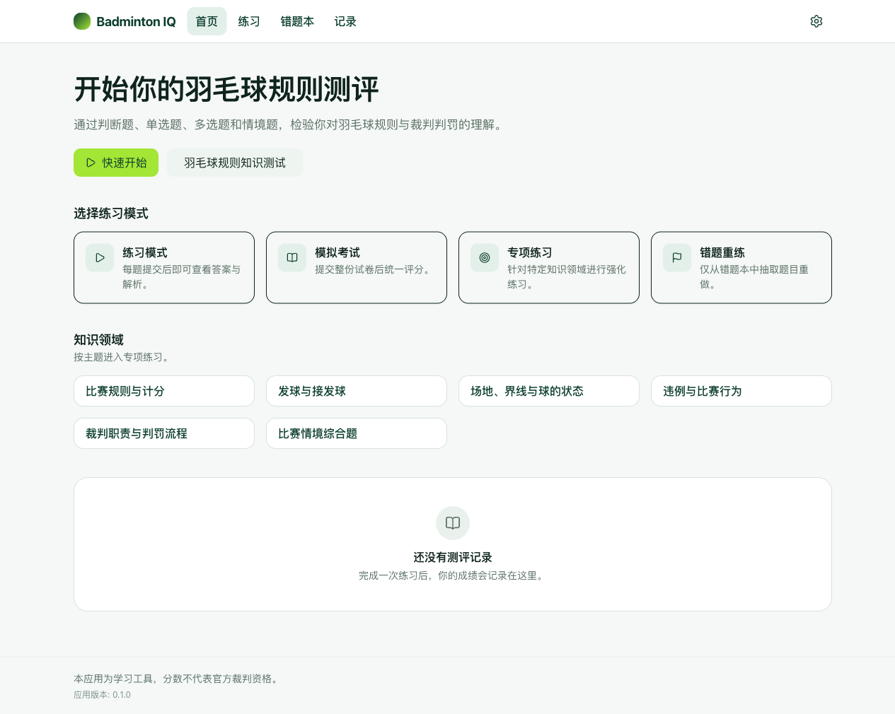
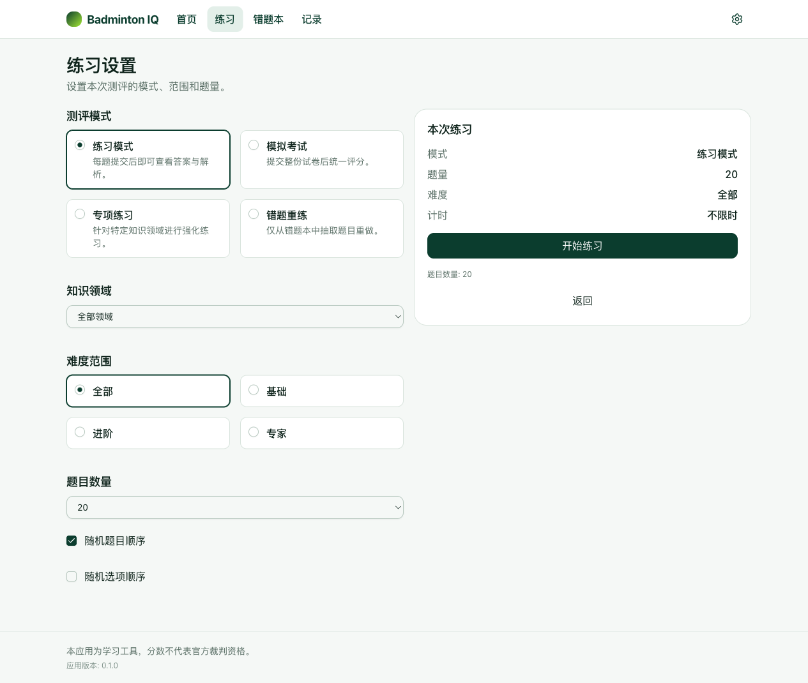
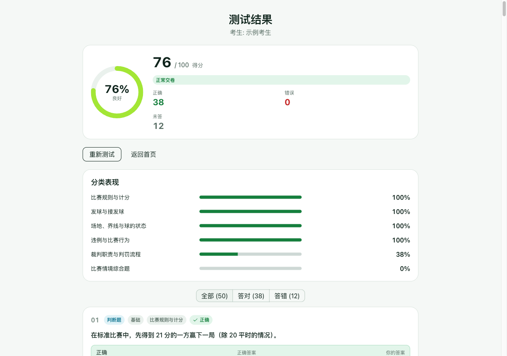
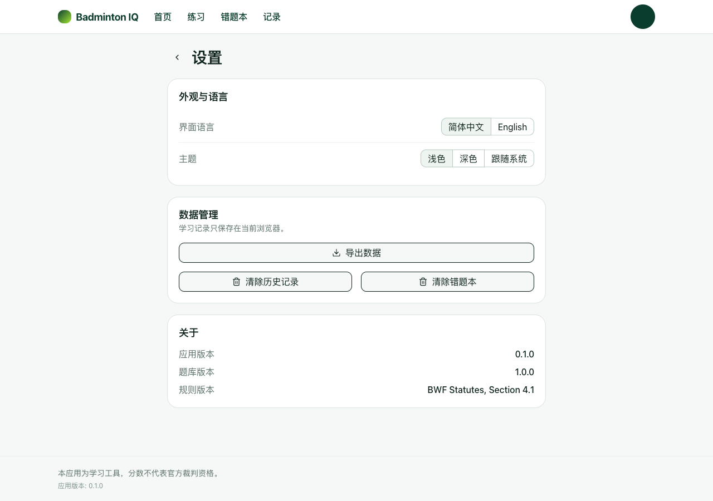

# Badminton IQ

一个中英双语的羽毛球规则知识学习与测评应用，面向 **BWF《羽毛球竞赛规则》（Laws of Badminton）**。应用提供自由练习模式，以及一套固定试卷、限时交卷的标准化测试，并在作答后给出逐题正确答案、解析与规则条款依据。

本应用是**纯前端单页应用**：没有后端、没有账号体系、不做云端同步，所有进度都保存在浏览器的本地存储中。

## 在线体验

- 在线体验：<https://officialbear.github.io/badminton-quiz/>
- 源码仓库：<https://github.com/OfficialBear/badminton-quiz>

## 功能特性

- **练习模式** —— 四种方式：练习模式、模拟考试、专项练习、错题重练。
- **正式测试模式** —— 固定 50 道题、每题 2 分（满分 100 分）、45 分钟倒计时，时间到自动交卷。
- **固定试卷 / 统一顺序** —— 所有考生使用同一套精选题目（见 `src/data/testPaper.ts`）。
- **昵称与成绩** —— 昵称用于在结果页标识考生；结果展示所得分数（如 `76 / 100`）与能力等级。
- **题型** —— 判断题、单选题、多选题、情境题。
- **逐题解析** —— 展示正确答案、你的答案、解析以及所依据的规则条款（`ruleClause`）。
- **答案筛选** —— 可按「答对 / 答错」筛选结果列表（未作答按答错处理）。
- **错题本** —— 收集练习中的错题用于重练，并可标记为已掌握。
- **练习记录** —— 本地保存历史练习记录。
- **考试专注监控** —— 考试期间离开考试页面（如切换标签页）累计 3 次将强制交卷。
- **状态恢复** —— 同一标签页会话内刷新可恢复进行中的考试；练习记录跨会话持久保存。
- **中英双语** —— 中文（默认）与英文，并在编译期校验两份词典的键对等。
- **响应式布局** —— 移动优先，适配桌面端。
- **主题** —— 浅色、深色、跟随系统。
- **本地数据导出** —— 可将本地数据导出为 JSON（不支持导入）。

## 截图

**桌面端**

|                首页                |                  练习模式                  |
| :--------------------------------: | :----------------------------------------: |
|  |  |

|                   考试说明                   |                   正式测试答题                   |
| :------------------------------------------: | :----------------------------------------------: |
|  |  |

|                    测试结果                    |                  设置                  |
| :--------------------------------------------: | :------------------------------------: |
|  |  |

**移动端**

|                      首页                       |
| :---------------------------------------------: |
|  |

## 技术栈

| 领域        | 技术                                                                   |
| ----------- | ---------------------------------------------------------------------- |
| 前端框架    | React 19                                                               |
| 语言        | TypeScript 6                                                           |
| 构建工具    | Vite 8                                                                 |
| 样式        | Tailwind CSS 4（`@tailwindcss/vite`）                                  |
| UI 组件库   | shadcn/ui（New York 风格，基于 Radix）                                 |
| 图标        | lucide-react                                                           |
| 路由        | react-router-dom 7（HashRouter）                                       |
| 消息提示    | sonner                                                                 |
| 样式工具    | class-variance-authority、clsx、tailwind-merge、`cn`、tw-animate-css   |
| 测试        | Vitest 5、@testing-library/react、@testing-library/user-event、jsdom   |
| 检查 / 格式 | ESLint 10（typescript-eslint、react-hooks、react-refresh）、Prettier 3 |
| 国际化      | 自研轻量实现（未使用外部 i18n 库）                                     |

## 环境要求

- **Node.js 22.12+**（Node 22 LTS 或 24）。Vitest 5 要求 `^22.12.0 || ^24.0.0 || >=26.0.0`，Vite 8 要求 `^20.19.0 || >=22.12.0`，取更严格者即 22.12+。部署工作流使用 Node 22。
- **npm**（本仓库以 `package-lock.json` 作为唯一锁文件）。

仓库未固定 `engines` 字段，也没有 Node 版本文件，因此上述版本依据依赖要求与 CI 配置确定。

## 快速开始

```bash
# 1. 克隆仓库
git clone https://github.com/OfficialBear/badminton-quiz.git
cd badminton-quiz

# 2. 安装依赖（使用 lockfile）
npm ci

# 3. 启动开发服务器
npm run dev
```

Vite 会打印本地访问地址（默认为 `http://localhost:5173/badminton-quiz/`），在浏览器中打开即可。应用在 `vite.config.ts` 中设置了 `base: '/badminton-quiz/'`，因此本地根路径 `/` 会自动重定向到该子路径。

## 可用脚本

| 脚本                   | 说明                                         |
| ---------------------- | -------------------------------------------- |
| `npm run dev`          | 启动 Vite 开发服务器。                       |
| `npm run build`        | 类型检查（`tsc -b`）并构建生产包到 `dist/`。 |
| `npm run preview`      | 本地预览已构建的 `dist/`。                   |
| `npm run lint`         | 对整个项目运行 ESLint。                      |
| `npm run lint:fix`     | 运行 ESLint 并自动修复。                     |
| `npm run typecheck`    | 以构建模式运行 TypeScript 编译器。           |
| `npm run test`         | 以监听模式运行 Vitest。                      |
| `npm run test:run`     | 单次运行 Vitest 测试套件（CI 模式）。        |
| `npm run format`       | 使用 Prettier 格式化项目。                   |
| `npm run format:check` | 仅检查格式，不写入改动。                     |

## 构建与测试

```bash
# 类型检查
npm run typecheck

# 单次运行自动化测试
npm run test:run

# 代码检查
npm run lint

# 生产构建
npm run build

# 本地预览生产构建产物
npm run preview
```

Vitest 测试套件（jsdom + Testing Library）覆盖：题库校验与分布规则、双语内容对等、评分引擎、测验 / 错题 / 存储服务、正式测试服务与端到端测试流程、路由行为、主题，以及 UI 组件。

## 部署

仓库包含 GitHub Actions 工作流 **`.github/workflows/deploy.yml`**，使用官方 Pages Action 构建并部署到 GitHub Pages。

**触发条件**

- 推送到 `main` 分支时自动触发。
- 也可通过 `workflow_dispatch` 手动触发。

**流水线**

1. 检出代码。
2. 安装 Node.js 22（带 npm 缓存）。
3. 通过 `npm ci` 安装依赖。
4. 运行 lint、类型检查与测试。
5. 运行生产构建。
6. 上传 `dist/` 产物并用 `actions/deploy-pages` 部署。

任一 lint、类型检查、测试或构建步骤失败都会终止部署。

**GitHub Pages 必要配置**

- 在仓库中进入：**Settings → Pages → Build and deployment → Source = GitHub Actions**。
- 工作流仅申请所需的最小权限（`contents: read`、`pages: write`、`id-token: write`），并为部署作业使用 `environment: github-pages`。
- `Setup Pages` 步骤使用 `actions/configure-pages` 并设置 `enablement: true`，尝试自动启用 Pages。若你的账号或组织策略阻止自动启用，请按上文手动启用（这是更可靠的方式）。

**基础路径**

`vite.config.ts` 设置了 `base: '/badminton-quiz/'`，与仓库名一致，因此应用从项目子路径（而非域名根路径）正确提供服务。由于使用了 **HashRouter**，深链接与刷新在 GitHub Pages 上无需额外的 404 处理即可正常工作。

**站点地址**

已部署并可访问：<https://officialbear.github.io/badminton-quiz/>（由 `main` 分支的 GitHub Actions 工作流自动发布）。

## 隐私与数据存储

应用**没有后端、没有账号体系，也不进行云端数据传输**，一切都运行在浏览器中。

| 数据                     | 存储位置                                                                     | 说明                 |
| ------------------------ | ---------------------------------------------------------------------------- | -------------------- |
| 应用设置（语言、主题）   | `localStorage`（`badminton-quiz:settings`）                                  | 持久保存，直到清除。 |
| 练习记录 / 历史          | `localStorage`（`badminton-quiz:attempts`、`badminton-quiz:active-attempt`） | 跨会话持久保存。     |
| 错题本                   | `localStorage`（`badminton-quiz:review`）                                    | 跨会话持久保存。     |
| 应用元数据（如最近打开） | `localStorage`（`badminton-quiz:meta`）                                      | 持久保存，直到清除。 |
| 正式测试会话             | `sessionStorage`（`badminton-quiz:test-session`）                            | 临时数据，见下文。   |

**正式测试详情**

- 当前测试（试卷、昵称、答案、切屏次数、截止时间）保存在 `sessionStorage` 中，作用域为当前标签页会话。
- **刷新恢复：** 在同一标签页会话内刷新考试页面可恢复进行中的测试。
- **关闭后不保证恢复：** 关闭标签页或结束会话会清空 `sessionStorage`，测试无法继续。
- 正式测试**不作为长期记录保存**；重新开始或返回首页时会清除该会话。

数据管理位于 **设置** 页：可将本地数据导出为 JSON，或清除练习记录 / 错题记录。（出于设计刻意不支持导入。）

## 考试规则

- 所有考生使用**同一套固定 50 题试卷**（`src/data/testPaper.ts`）。
- 每题 **2 分**，满分 **100 分**。
- **昵称**仅用于在结果页标识考生。
- 测试限时 **45 分钟**，时间到自动交卷。
- 离开考试页面（例如切换浏览器标签页）累计 **3 次**将强制交卷。
- 同一标签页会话内刷新可恢复当前测试；关闭页面不保证恢复。
- 本项目是**纯前端应用**，切屏检测只是轻量的完整性手段，**并非**不可绕过的防作弊机制。

## 题库与规则依据

- **组织方式：** 题目位于 `src/data/bank/`，按分类拆分（`scoring`、`service`、`court`、`faults`、`officials`、`scenario`），并在 `src/data/questionBank.ts` 中汇总。
- **规模与分布（当前）：** 114 道唯一题，覆盖 6 个分类、4 种题型（判断题、单选题、多选题、情境题）与 3 个难度（基础、进阶、专家）。
- **规则来源：** 题目依据 **《BWF Statutes, Section 4.1 — Laws of Badminton》** 编写（规则版本记为 `BWF Statutes, Section 4.1`）。每道题都带 `ruleClause`（例如 `Law 7.2`），可回溯到具体条款。
- **官方入口：** 项目审核清单中记录的 BWF 规则入口为 <https://corporate.bwfbadminton.com/statutes/>。
- **审核状态：** 当前所有题目均为 `reviewStatus: 'verified'`。该标记含义是**「准予在本应用中使用」**，**不等同于**已完成逐题人工规则复核。结构与分布由 `src/services/bankValidation.ts` 自动校验，而规则正确性属于人工流程，详见 [`docs/question-bank-review.md`](docs/question-bank-review.md)。
- **版本：** `QUESTION_BANK_VERSION = '1.0.0'`。

## 项目结构

```
badminton-quiz/
├─ public/                       # 原样提供的静态资源（favicon、图标）
├─ src/
│  ├─ components/
│  │  ├─ layout/                 # 应用外壳：页头、页脚、导航、切换器
│  │  ├─ shadcn/                 # shadcn/ui 基础组件（基于 Radix）
│  │  ├─ ui/                     # 应用级设计系统组件
│  │  └─ icons/                  # 图标集
│  ├─ data/
│  │  ├─ bank/                   # 按分类拆分的题库（6 个文件）
│  │  ├─ questionBank.ts         # 汇总题库 + 题库/规则版本
│  │  ├─ testPaper.ts            # 固定 50 题试卷
│  │  ├─ bankTargets.ts          # 题库目标分布
│  │  ├─ categories.ts           # 分类 / 难度 / 题型元数据
│  │  └─ modes.ts                # 练习模式
│  ├─ i18n/                      # 中英词典、Provider 与对等校验
│  ├─ pages/                     # 路由页面（pages/test/ 为考试相关页面）
│  ├─ router/                    # Hash 路由、路由表、路径辅助函数
│  ├─ services/                  # 测验、评分、错题、存储、题库校验、正式测试
│  ├─ styles/                    # Tailwind 入口与设计令牌
│  ├─ theme/                     # 主题 Provider（浅色/深色/跟随系统）
│  ├─ types/                     # 共享 TypeScript 类型
│  └─ utils/                     # 时间、id、乱序等工具
├─ .github/workflows/deploy.yml  # GitHub Pages 部署工作流
├─ docs/
│  ├─ screenshots/               # README 截图
│  └─ question-bank-review.md    # 题库审核清单
├─ design.md                     # 产品需求与技术实现规范
├─ index.html
└─ vite.config.ts
```

## 许可证

> **TODO：** 本仓库**不包含** `LICENSE` 文件，未授予任何开源许可证。若打算开源发布，请先补充许可证文件。
